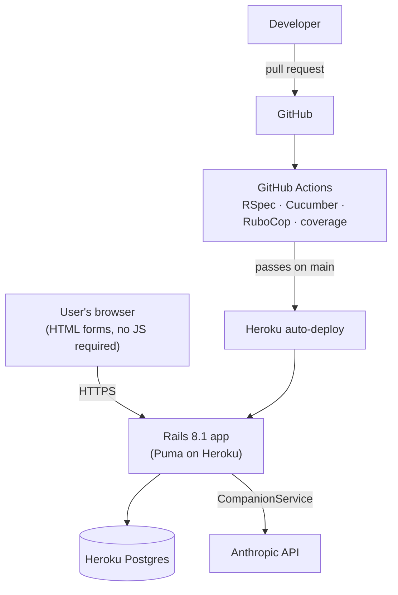
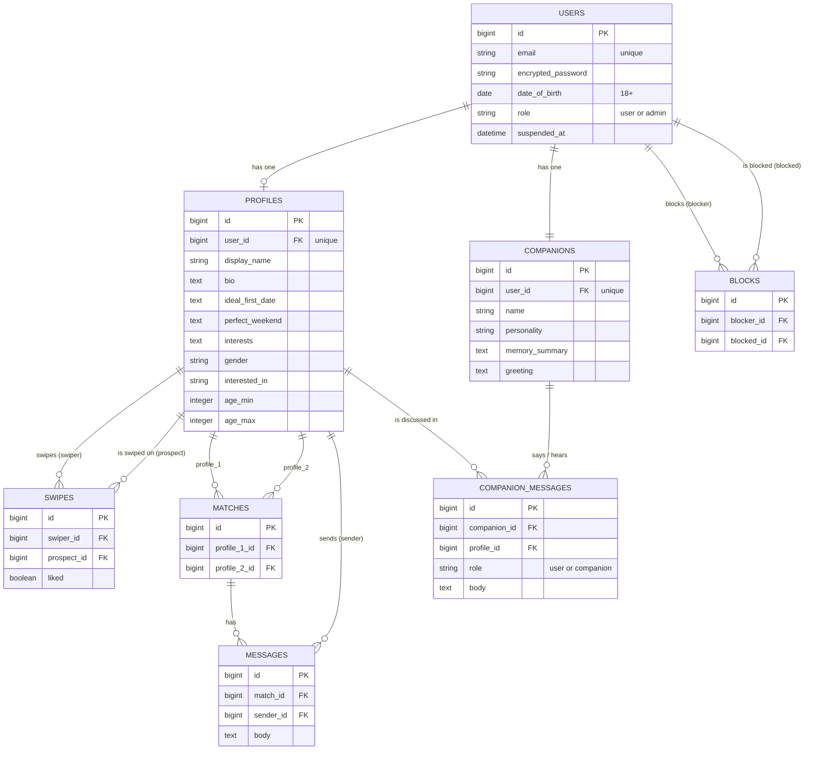

# wingmAIn

A dating web app where you never browse alone: every user gets an AI companion that reacts to profiles, chats with them about each person, and helps them start conversations.

- **Live app:** https://wingmain-427a5124258b.herokuapp.com
- **Product Backlog:** [GitHub Projects board](https://github.com/orgs/tamu-edu-students/projects/207) · [Burnup charts](https://github.com/orgs/tamu-edu-students/projects/207/insights)
- **Team:** Colin Bakker, Jason Atkins, Christopher Parker, Zachary Williams, Can Ercan, Sugam Mishra

---

# Technical Documentation

## Tech stack

- Ruby 3.4.5, Rails 8.1
- PostgreSQL 16
- Devise (authentication)
- Anthropic API (AI companion), wrapped in `CompanionService`
- RSpec + FactoryBot + Shoulda Matchers (unit tests), Cucumber + Capybara (acceptance tests), SimpleCov (coverage), RuboCop (style)
- Hosted on Heroku with Heroku Postgres; CI on GitHub Actions

Every page is server-rendered with plain HTML forms, so the app works with JavaScript disabled.

## From zero to running locally

### 1. Install prerequisites (macOS shown)

```bash
brew install rbenv ruby-build postgresql@16
rbenv install 3.4.5
brew services start postgresql@16
```

### 2. Clone and set up

```bash
git clone https://github.com/tamu-edu-students/CSCE606-700-Fall2026-GroupRed.git
cd CSCE606-700-Fall2026-GroupRed
bundle install
bin/rails db:prepare   # creates and migrates the development and test databases
bin/rails db:seed      # demo data: an admin, 30 profiles, sample swipes and a match
bin/rails server
```

Open http://localhost:3000.

**Demo logins** (local and production): any seeded profile, e.g. `peter.parker@wingmain.test`, password `password123`. Peter already has a match with Selina Kyle, so his Matches page isn't empty.
The admin account is `admin@wingmain.test`; locally its password is `password123`.

**AI companion locally:** set `ANTHROPIC_API_KEY` to get real AI replies. Without it, the companion shows a friendly fallback message and everything else works. The test suites always remove this key, so tests never call the real API.

### 3. Run the tests

```bash
bundle exec rspec       # unit tests
bundle exec cucumber    # acceptance tests
bin/rubocop             # style
```

The RSpec suite includes a JavaScript-enabled axe accessibility test. The
`axe-core-capybara` gem is locked in `Gemfile.lock`, and CI installs Chrome
automatically. For local system tests, install Google Chrome (or Chromium)
using your operating system's package manager, then run:

```bash
bundle install
bundle exec rspec spec/system/accessibility_spec.rb
```

CI runs each suite separately and fails if RSpec, Cucumber, or the combined total is under 90% line coverage. To check locally:

```bash
rm -rf coverage
COVERAGE_DIR=coverage/rspec bundle exec rspec
COVERAGE_DIR=coverage/cucumber bundle exec cucumber
```

Each run prints its coverage; the HTML report is in that folder's `index.html`.

After every `git pull`, run `bundle install` and `bin/rails db:migrate` to pick up teammates' new gems and tables.

## From zero to deployed (fresh fork)

1. **Create the Heroku app and database**
   ```bash
   heroku create your-app-name
   heroku addons:create heroku-postgresql:essential-0 -a your-app-name
   ```
2. **Credentials.** A fresh fork can't decrypt our `config/credentials.yml.enc`. Generate your own:
   ```bash
   rm config/credentials.yml.enc
   EDITOR=true bin/rails credentials:edit   # creates config/master.key and new credentials
   heroku config:set RAILS_MASTER_KEY=$(cat config/master.key) -a your-app-name
   ```
   Commit the new `credentials.yml.enc`. Never commit `config/master.key`.
3. **Other config vars**
   ```bash
   heroku config:set ADMIN_PASSWORD='choose-a-strong-password' -a your-app-name
   heroku config:set ANTHROPIC_API_KEY='your-key' -a your-app-name   # optional
   heroku config:set AWS_ACCESS_KEY_ID='...' AWS_SECRET_ACCESS_KEY='...' \
     AWS_REGION='your-bucket-region' AWS_S3_BUCKET='your-bucket' -a your-app-name   # profile photos
   ```
4. **Automatic deploys:** Heroku dashboard → your app → **Deploy** → connect to GitHub → choose the repo → enable **Automatic deploys** from `main` with **Wait for CI to pass** checked. Click **Deploy Branch** once.
5. **Migrations** run automatically on each release (`release` line in the `Procfile`).
6. **Seed demo data**
   ```bash
   heroku run bin/rails db:seed -a your-app-name
   ```

### Our deployment

- Every merge to `main` deploys automatically once CI passes.
- `main` is protected: changes go through a pull request with one approval and passing CI.
- Secrets live only in Heroku config vars: `RAILS_MASTER_KEY`, `DATABASE_URL` (set by Heroku Postgres), `ADMIN_PASSWORD`, `ANTHROPIC_API_KEY`, and `AWS_ACCESS_KEY_ID`, `AWS_SECRET_ACCESS_KEY`, `AWS_REGION`, `AWS_S3_BUCKET` (profile photos are stored in S3, in `us-east-2`).
- Logs: `heroku logs --tail -a wingmain`

## Architecture

### System diagram



### Database diagram (current schema)



### Key classes

| Class | Responsibility |
| --- | --- |
| `User` | Devise account (18+); owns a profile and companion; block helpers (`blocked_with?`, `User.not_blocked_with`) |
| `Profile` | Dating profile and preferences, with validations (name ≤ 40, bio ≤ 500, ages ≥ 18) |
| `Swipe` | One profile liking or passing on another; one swipe per pair, never yourself |
| `Match` | Created when two profiles like each other; one per pair |
| `Message` | A message between the two people in a match (1–1000 characters); only someone in the match can send one |
| `Companion` | The user's AI companion; created at sign-up; name and personality are customizable; 20 chat messages per day |
| `CompanionMessage` | The companion's reaction to a profile and the chat about it |
| `CompanionService` | Calls the AI for greetings, profile reactions, feedback, openers, and chats. Conversation reply suggestions also use the latest 10 match messages. Account email and birth-date fields are excluded; requests have a 10-second timeout, and callers show a fallback on API errors. |
| `Block` | One user blocking another; blocks apply both ways |

---

# User Guide

## Getting started

1. Go to the home page and click **Sign up** in the header.
2. Enter your email, date of birth (you must be 18 or older), and a password (6+ characters).
3. Create your profile: display name, bio, gender, who you're interested in, and the age range you're looking for.

Returning users click **Sign in** in the header. When you're signed in, the header has **Discover**, **Matches** and **Companion**, an **Account** menu (Profile, Blocked people, My reports, Account settings, and Admin for admins), and **Sign out**. The home page has shortcut cards to the same places.

## Your profile

- **View it** with **Account → Profile** (`/profile`).
- **Edit it** with **Edit profile**. If something is invalid (e.g. an age under 18), the form explains what to fix.
- **Add a photo** on the edit page: choose a JPG or PNG up to 5 MB and describe it in **Photo alt text** (required, so screen readers can describe it), then click **Save profile**.
- Profile photos appear on profile pages, Discover, My Matches, conversation pages, and swipe-history profile popups. Photos include the uploader's alt text. Profiles without a photo show "No photo yet."
- **Prompts and interests:** optionally answer "Ideal first date" and "A perfect weekend," and list your interests. Each field allows up to 500 characters.
- Filled-in answers appear on your profile, other people's view of your profile, and swipe-history profile popups. Your companion also receives them for reactions, conversation starters, chat, and profile feedback.
- **Get feedback** by clicking **What do you think?** on your profile; your companion gives honest tips on improving it.
- **Delete it** with **Delete profile** and confirm. Your account stays, so you can create a new profile later.

## Swiping through profiles

Click **Discover** (`/swipes`). You'll see one profile at a time, chosen to fit both ways: they match your gender and age preferences, and you match theirs. Blocked and banned people never appear.

- Click **Like** or **Pass** to move to the next profile.
- When you and someone both like each other, you'll see **"It's a match!"**
- When there's no one left, the page says **No more profiles available.**
- Made a mistake? Click **Undo Last Swipe** and confirm; that profile comes back. If the swipe had made a match, the match and its conversation are removed.
- Click **View Swipe History** to see everyone you've liked and passed on. Click **View** to see their profile, or **Change Decision** to switch a like to a pass (or the other way around).
- You can't swipe on yourself, on someone twice, or on a banned user; the page tells you why.

## Your AI companion

Every account comes with a companion named **Wingman**.

- **On Discover,** your companion reacts to each profile ("Wingman says…").
- **Ask it about the profile** in the box under its reaction and click **Send**. Your conversation about that person stays on the page.
- **Meet and customize it** with **Companion** (`/companion`): click **Customize Wingman** to change its name and personality. It will greet you again in its new voice.
- If a reply is inappropriate, click **Report this reply**; the admins see it quoted.
- Your companion can handle up to 20 requests a day (chat, opener ideas, reply suggestions and feedback all count).

If the AI service is unavailable, you'll see a short "taking a break" message and the rest of the app keeps working.

## Your matches

Click **Matches** (`/matches`) to see everyone you've matched with. People you've blocked, who blocked you, or who are banned don't appear.

Click **Message &lt;name&gt;** to open your conversation with a match (`/matches/<id>`). Messages from both of you are listed oldest to newest, with who sent each one. Type in the box and click **Send**; a blank message isn't sent. There are no live updates (the app works without JavaScript), so refresh the page to see new replies. If either of you blocks the other, the conversation closes.

Not sure what to say? Click **Help me start** for three opener ideas based on their profile, then **Use this** to put one in the message box.

Click **Suggest a reply** to get a draft based on your match's profile and the 10 most recent messages. If the conversation is empty, it suggests an opening message. You can edit the draft before clicking **Send**; suggestions are never sent automatically. Each successful suggestion counts toward your companion's daily limit of 20 requests.

After **Send**, **Suggest a reply**, **Help me start**, or **Use this**, the page returns to the message box. Feedback also appears beside the box. This works with JavaScript disabled.

Each message from your match has a **Report** button, which sends the message (quoted) to the admins; they can ban the sender from the report. You can **Delete** any message you sent, which removes it for both of you.

## Viewing, blocking and reporting people

- Each person has a profile page at `/people/<id>`, reachable with **View &lt;name&gt;'s profile** on Discover, My Matches and conversations.
- Click **Block &lt;their name&gt;** on their profile and confirm. Blocking works both ways: neither of you can see the other's profile, swipe on each other, or appear in each other's matches.
- Manage blocks at **Account → Blocked people**, where you can **Unblock** anyone.
- Click **Report &lt;their name&gt;** on their profile, give a reason (up to 500 characters), and click **Submit report**. You can't report yourself.
- See what you've reported, and its status, at **Account → My reports**.

## Moderation (admins)

Admins sign in with the admin account and open **Account → Admin** (`/admin`).

- **Open reports** lists each report with the reason and who sent it.
- **Ban &lt;name&gt;** suspends the account and resolves that person's open reports. Banned users can't sign in, and they disappear from Discover, Matches and conversations.
- **Dismiss report about &lt;name&gt;** closes a report without action.
- **Banned accounts** lists suspended users; **Pardon &lt;name&gt;** restores one.
- Only admins can open the dashboard; everyone else is sent to the "Not authorized" page.
