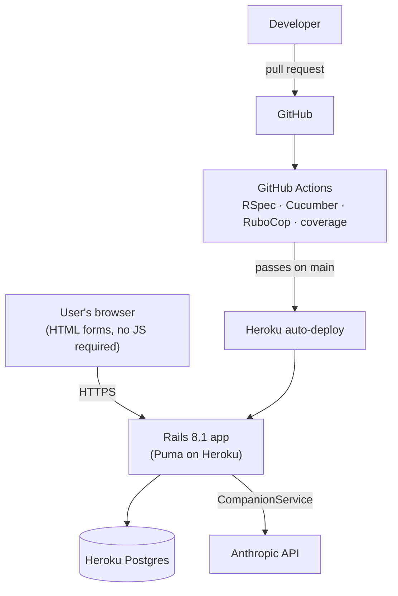
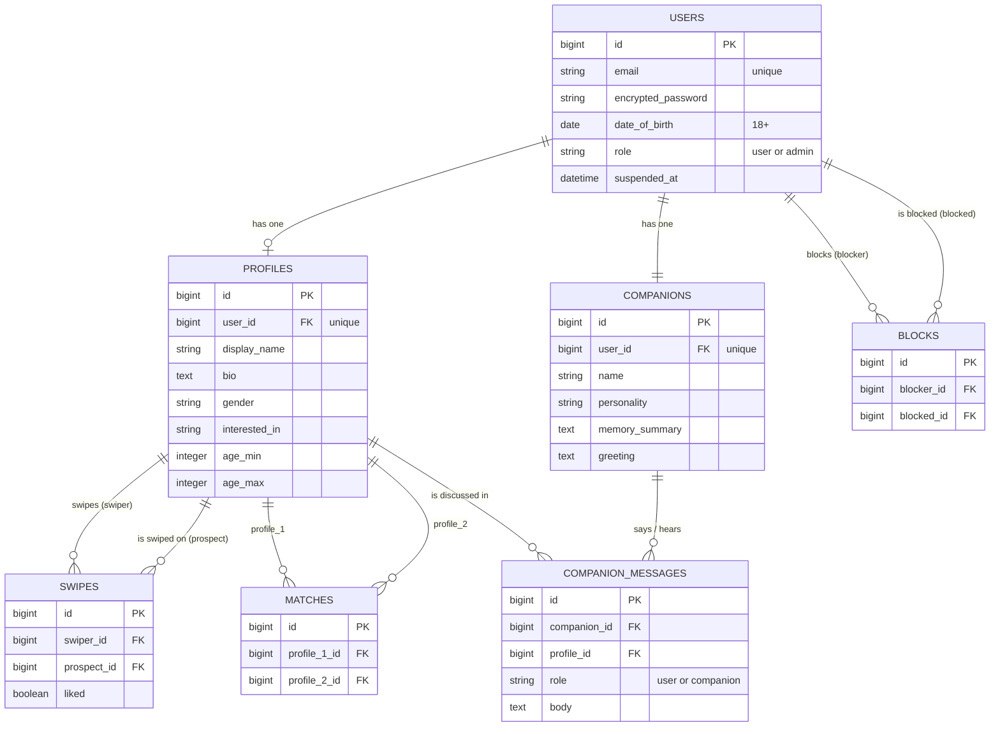

# wingmAIn

A dating web app where you never browse alone: every user gets an AI companion that reacts to profiles, chats with them about each person, and helps them start conversations.

- **Live app:** https://wingmain-427a5124258b.herokuapp.com
- **Product Backlog:** [GitHub Projects board](https://github.com/orgs/tamu-edu-students/projects/207) · [Burnup charts](https://github.com/orgs/tamu-edu-students/projects/207/insights)
- **Team:** Colin Bakker, Jason Atkins, Christopher Parker, Zachary Williams, Can Ercan, Sugam Mishra

---

# Technical Documentation

## Tech stack

- Ruby 3.4.5, Rails 8.1
- PostgreSQL 16
- Devise (authentication)
- Anthropic API (AI companion), wrapped in `CompanionService`
- RSpec + FactoryBot + Shoulda Matchers (unit tests), Cucumber + Capybara (acceptance tests), SimpleCov (coverage), RuboCop (style)
- Hosted on Heroku with Heroku Postgres; CI on GitHub Actions

Every page is server-rendered with plain HTML forms, so the app works with JavaScript disabled.

## From zero to running locally

### 1. Install prerequisites (macOS shown)

```bash
brew install rbenv ruby-build postgresql@16
rbenv install 3.4.5
brew services start postgresql@16
```

### 2. Clone and set up

```bash
git clone https://github.com/tamu-edu-students/CSCE606-700-Fall2026-GroupRed.git
cd CSCE606-700-Fall2026-GroupRed
bundle install
bin/rails db:prepare   # creates and migrates the development and test databases
bin/rails db:seed      # demo data: an admin, 30 profiles, sample swipes and a match
bin/rails server
```

Open http://localhost:3000.

**Demo logins** (local and production): any seeded profile, e.g. `peter.parker@wingmain.test`, password `password123`. Peter already has a match with Selina Kyle, so his Matches page isn't empty.
The admin account is `admin@wingmain.test`; locally its password is `password123`.

**AI companion locally:** set `ANTHROPIC_API_KEY` to get real AI replies. Without it, the companion shows a friendly fallback message and everything else works. The test suites always remove this key, so tests never call the real API.

### 3. Run the tests

```bash
bundle exec rspec       # unit tests
bundle exec cucumber    # acceptance tests
bin/rubocop             # style
```

The RSpec suite includes a JavaScript-enabled axe accessibility test. The
`axe-core-capybara` gem is locked in `Gemfile.lock`, and CI installs Chrome
automatically. For local system tests, install Google Chrome (or Chromium)
using your operating system's package manager, then run:

```bash
bundle install
bundle exec rspec spec/system/accessibility_spec.rb
```

CI runs each suite separately and fails if RSpec, Cucumber, or the combined total is under 90% line coverage. To check locally:

```bash
rm -rf coverage
COVERAGE_DIR=coverage/rspec bundle exec rspec
COVERAGE_DIR=coverage/cucumber bundle exec cucumber
```

Each run prints its coverage; the HTML report is in that folder's `index.html`.

After every `git pull`, run `bundle install` and `bin/rails db:migrate` to pick up teammates' new gems and tables.

## From zero to deployed (fresh fork)

1. **Create the Heroku app and database**
   ```bash
   heroku create your-app-name
   heroku addons:create heroku-postgresql:essential-0 -a your-app-name
   ```
2. **Credentials.** A fresh fork can't decrypt our `config/credentials.yml.enc`. Generate your own:
   ```bash
   rm config/credentials.yml.enc
   EDITOR=true bin/rails credentials:edit   # creates config/master.key and new credentials
   heroku config:set RAILS_MASTER_KEY=$(cat config/master.key) -a your-app-name
   ```
   Commit the new `credentials.yml.enc`. Never commit `config/master.key`.
3. **Other config vars**
   ```bash
   heroku config:set ADMIN_PASSWORD='choose-a-strong-password' -a your-app-name
   heroku config:set ANTHROPIC_API_KEY='your-key' -a your-app-name   # optional
   ```
4. **Automatic deploys:** Heroku dashboard → your app → **Deploy** → connect to GitHub → choose the repo → enable **Automatic deploys** from `main` with **Wait for CI to pass** checked. Click **Deploy Branch** once.
5. **Migrations** run automatically on each release (`release` line in the `Procfile`).
6. **Seed demo data**
   ```bash
   heroku run bin/rails db:seed -a your-app-name
   ```

### Our deployment

- Every merge to `main` deploys automatically once CI passes.
- `main` is protected: changes go through a pull request with one approval and passing CI.
- Secrets live only in Heroku config vars: `RAILS_MASTER_KEY`, `DATABASE_URL` (set by Heroku Postgres), `ADMIN_PASSWORD`, `ANTHROPIC_API_KEY`.
- Logs: `heroku logs --tail -a wingmain`

## Architecture

### System diagram



### Database diagram (current schema)



### Key classes

| Class | Responsibility |
| --- | --- |
| `User` | Devise account (18+); owns a profile and companion; block helpers (`blocked_with?`, `User.not_blocked_with`) |
| `Profile` | Dating profile and preferences, with validations (name ≤ 40, bio ≤ 500, ages ≥ 18) |
| `Swipe` | One profile liking or passing on another; one swipe per pair, never yourself |
| `Match` | Created when two profiles like each other; one per pair |
| `Companion` | The user's AI companion; created at sign-up; name and personality are customizable; 20 chat messages per day |
| `CompanionMessage` | The companion's reaction to a profile and the chat about it |
| `CompanionService` | Only place that calls the AI API: greetings, profile reactions (`react`), and chat replies (`reply`); sends only profile fields, never email or birth date; 10-second timeout and a fallback message on errors |
| `Block` | One user blocking another; blocks apply both ways |

---

# User Guide

## Getting started

1. Go to the home page and click **Sign Up**.
2. Enter your email, date of birth (you must be 18 or older), and a password (6+ characters).
3. Click **View your profile** and create your profile: display name, bio, gender, who you're interested in, and the age range you're looking for.

Returning users click **Sign In** on the home page. When you're signed in, the home page shows links to your profile, matches, swiping, and **Account Settings** (change your email or password), plus a **Sign Out** button.

## Your profile

- **View it** with **View your profile** (`/profile`).
- **Edit it** with **Edit profile**. If something is invalid (e.g. an age under 18), the form explains what to fix.

## Swiping through profiles

Click **Swipe through profiles** (`/swipes`). You'll see one profile at a time, chosen to fit both ways: they match your gender and age preferences, and you match theirs. Blocked people never appear.

- Click **Like** or **Dislike** to move to the next profile.
- When you and someone both like each other, you'll see **"It's a match!"**
- When there's no one left, the page says **No more profiles available.**

## Your AI companion

Every account comes with a companion named **Wingman**.

- **On the swipe page,** your companion reacts to each profile ("Wingman says…").
- **Ask it about the profile** in the box under its reaction and click **Send**. Your conversation about that person stays on the page. You can send up to 20 messages a day.
- **Meet and customize it** at `/companion`: click **Customize Wingman** to change its name and personality. It will greet you again in its new voice.

If the AI service is unavailable, you'll see a short "taking a break" message and the rest of the app keeps working.

## Your matches

Click **View your matches** (`/matches`) to see everyone you've matched with. People you've blocked, or who blocked you, don't appear.

## Viewing and blocking people

- Each person has a profile page at `/people/<id>`.
- Click **Block <their name>** on their profile and confirm. Blocking works both ways: neither of you can see the other's profile, swipe on each other, or appear in each other's matches.
- Manage blocks at **View your profile → Blocked people**, where you can **Unblock** anyone.

## Coming soon (in progress)

Messaging your matches, profile photos, reporting users, and moderation are being built in Sprint 2.
