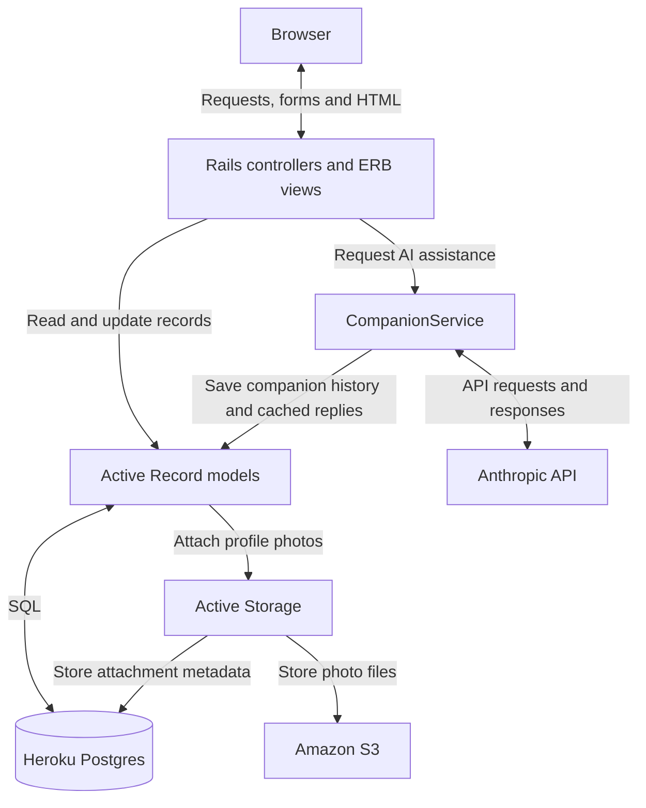

# System architecture

wingmAIn is a server-rendered Rails application hosted on Heroku. PostgreSQL stores application records, Amazon S3 stores uploaded profile photos, and Anthropic provides AI responses through `CompanionService`.

## Runtime diagram

## Main components

| Component | Responsibility |
| --- | --- |
| Controllers and ERB views | Handle requests, validate submitted data, render pages and redirect after actions. |
| Devise | Register and authenticate users. Suspended accounts cannot authenticate. |
| Pundit and controller checks | Restrict access to private conversations, reports and admin actions. |
| Active Record | Store accounts, profiles, swipes, matches, messages, companion history, blocks and reports. |
| Active Storage | Attach a photo to a profile. Photo metadata is stored in PostgreSQL; production photo files are stored in S3. |
| CompanionService | Build prompts, call Anthropic, handle API failures and save successful companion responses. |

## Conversations and inbox

A conversation belongs to a `Match` between two profiles. Its messages are stored in `messages`; there is no separate conversations table.

The inbox lists matches that have messages and orders them by their latest message. Incoming messages with `seen: false` contribute to the unread count. Opening a conversation marks the other person's messages as seen.

`MatchConversation` checks that the current user can access the match. Blocked or suspended participants are excluded from accessible conversations.

Messages are loaded when the page is requested. There is no live message subscription; users send a message or refresh to see updates.

## AI requests

AI calls happen during the web request through `CompanionService`. The API client has a 10-second timeout and no retries. A missing key, empty response or handled API error produces a friendly fallback through the calling feature.

The service supports greetings, profile reactions, companion chat, opener ideas, profile feedback, reply suggestions and weekly recaps. Greetings and reactions are saved for reuse. Weekly recaps summarize recent activity and are cached for the current day.

Reply suggestions use the match's profile and the latest 10 conversation messages. The result fills an editable draft. A message is sent to the match only when the user submits the message form.

## Profile photos

A profile can have one attached photo. The model validates JPG or PNG format, a maximum size of 5 MB, and required alt text.

Production uses the `amazon` Active Storage service. S3 configuration comes from environment variables. PostgreSQL stores the blob and attachment records, rather than the photo file itself.

## Build and deployment

1. Changes are proposed through a GitHub pull request.
2. GitHub Actions sets up Ruby, PostgreSQL and Chrome.
3. CI creates the test database and loads its schema without running the demo seeds.
4. CI runs RSpec, Cucumber, coverage checks and RuboCop. RSpec, Cucumber and combined line coverage must each reach 90%.
5. The documented Heroku setup deploys `main` after CI passes.
6. The Heroku release command runs database migrations. The web process runs Puma.

Demo seeding is a separate command. It is not part of the release command.

## Source references

- [Routes](../config/routes.rb)
- [Conversation access checks](../app/controllers/concerns/match_conversation.rb)
- [Inbox controller](../app/controllers/conversations_controller.rb)
- [Match controller](../app/controllers/matches_controller.rb)
- [Companion service](../app/services/companion_service.rb)
- [Profile model](../app/models/profile.rb)
- [Storage configuration](../config/storage.yml)
- [Production configuration](../config/environments/production.rb)
- [Database schema](../db/schema.rb)
- [CI workflow](../.github/workflows/ci.yml)
- [Heroku process commands](../Procfile)
- [AI service decision](adr/0001-route-ai-calls-through-companion-service.md)
- [Server-rendered interface decision](adr/0002-server-rendered-pages-without-javascript.md)
- [CI coverage decision](adr/0003-enforce-coverage-per-suite-in-ci.md)
