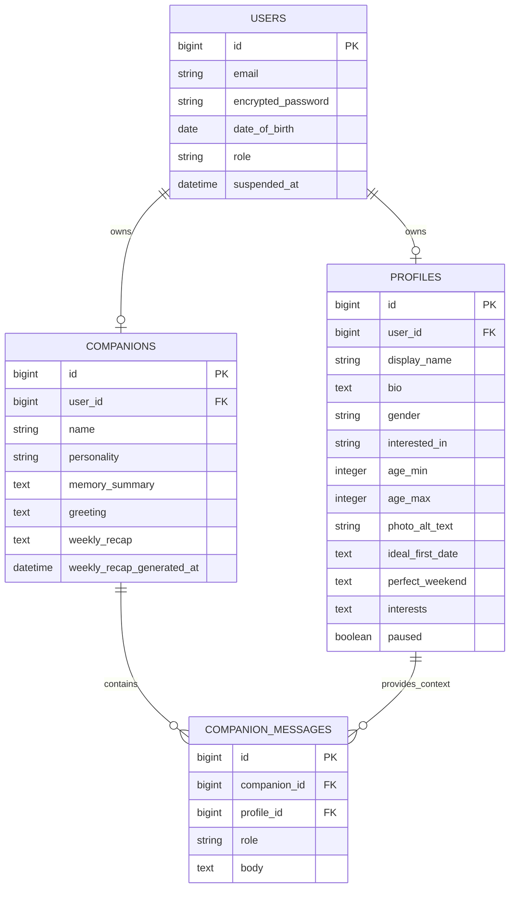
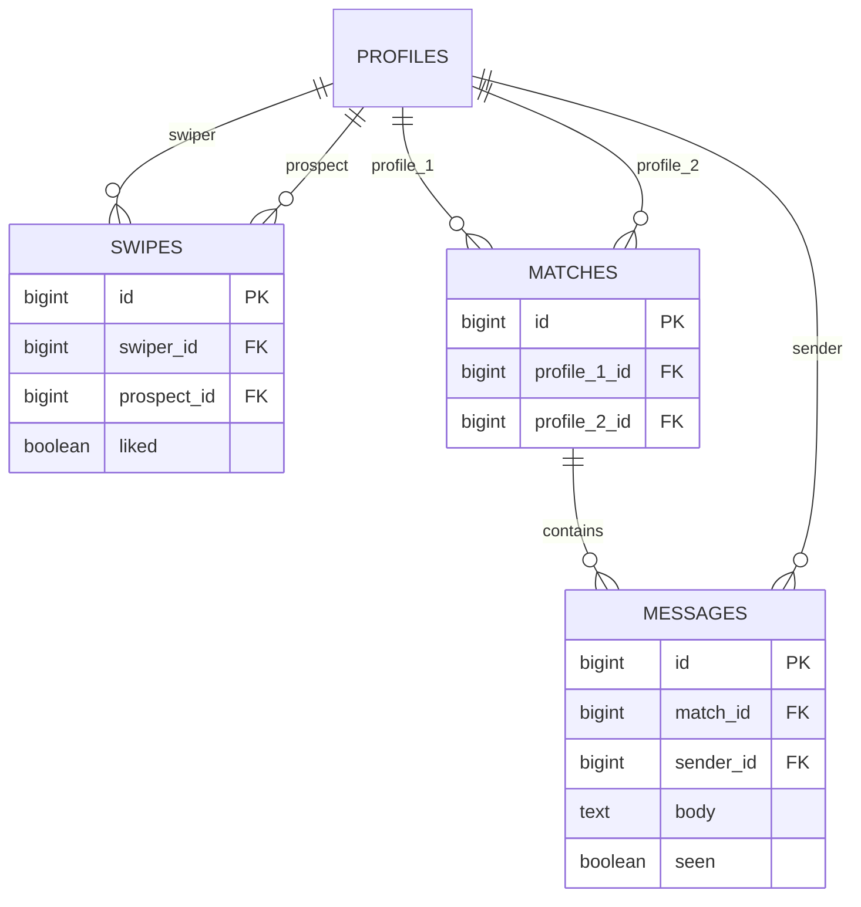
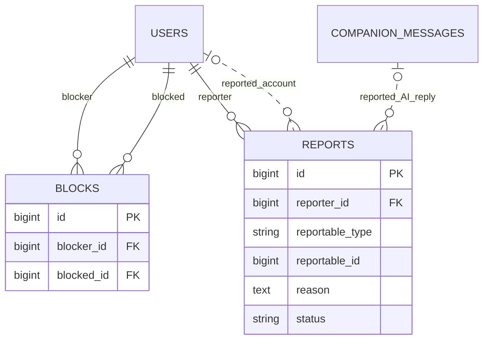
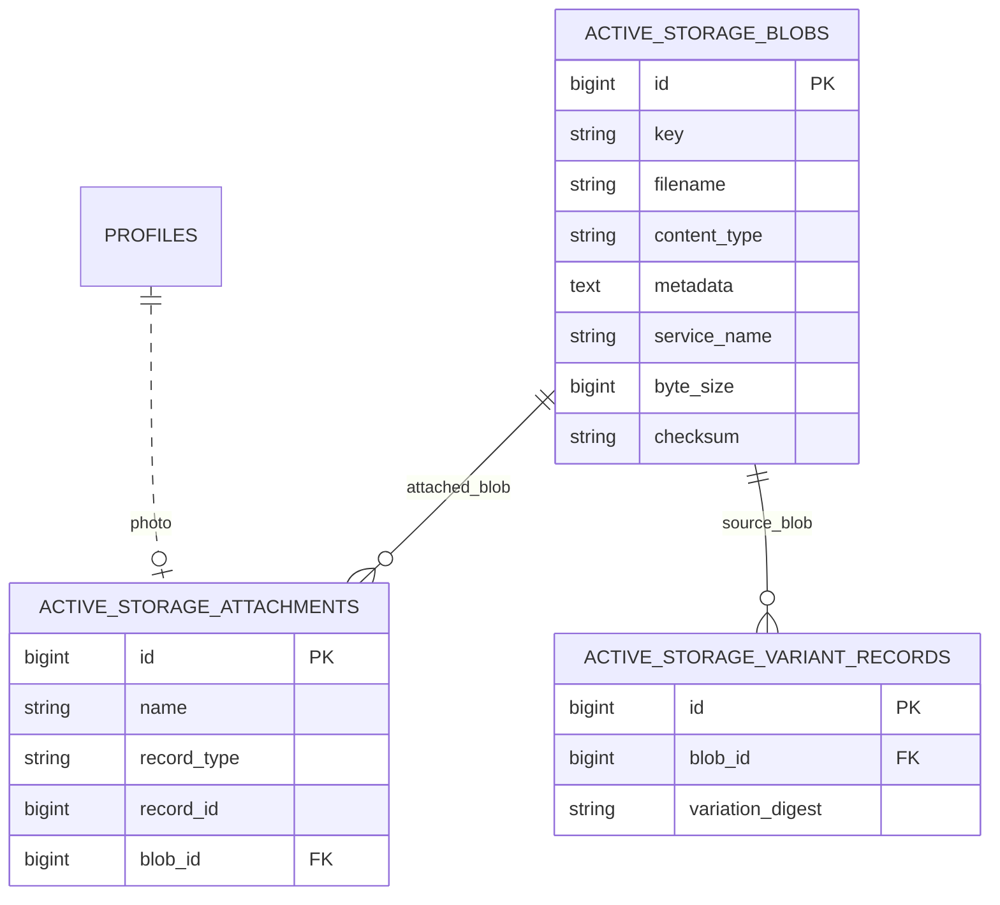

# Data model

The database uses PostgreSQL. These diagrams describe the application tables and Active Storage tables in [db/schema.rb](../db/schema.rb).

`PK` means primary key and `FK` means database foreign key. Routine timestamp columns are omitted from the diagrams. Relationships implemented through polymorphic references are explained separately.

## Accounts, profiles and companions

- Email addresses are unique. Profile and companion `user_id` columns each have a unique index.
- Sign-up creates a default companion. A user can create or delete their profile without deleting their account.
- Profile prompts and interests are optional, with a server-side limit of 500 characters each.
- `paused` defaults to `false`. It controls profile visibility without deleting the profile.
- `suspended_at` records an account suspension; it is separate from pausing a profile.
- Companion messages belong to both a companion and the profile being discussed.
- Companion message roles are `user` or `companion`. User text is limited to 500 characters; companion text is limited to 2,000.
- The daily allowance counts companion messages with role `user` created during the current day. The limit is 20.
- Weekly recap text and its generation time are cached on the companion record.

## Swipes, matches and messages

- A swipe records a like or pass from one profile to another.
- A unique index prevents duplicate `(swiper_id, prospect_id)` pairs. A database check also prevents swiping on yourself.
- Matches have a unique index on `(profile_1_id, profile_2_id)`.
- The message model requires the sender to belong to the match. Message bodies are stripped of surrounding whitespace and must contain 1–1,000 characters.
- `seen` defaults to `false`. Opening a conversation marks incoming messages from the other participant as seen.
- There is no separate conversations table. The inbox queries matches and their messages to calculate recent activity and unread counts.
- Destroying a match through the model also destroys its messages.

## Blocks and reports

- Blocks reference user accounts, not profiles. The `(blocker_id, blocked_id)` pair is unique, and the model prevents self-blocking.
- A block is stored in one direction, but visibility and conversation checks treat a block in either direction as restricting access.
- Every report belongs to its reporter and one reportable record.
- `reportable_type` and `reportable_id` form a polymorphic reference. Current report flows target either a `User` or a `CompanionMessage`, not both.
- The dotted report relationships are application associations, not database foreign keys to the target tables. `reporter_id` is a database foreign key.
- Reporting a person's message creates a report against the sender's user account and includes a quoted excerpt in `reason`. It does not create a foreign key to the message.
- Report statuses are `open`, `resolved` or `dismissed`. The default is `open`, and the reason is limited to 500 characters.

## Profile photo storage

- `Profile` declares `has_one_attached :photo`.
- For a profile photo, the attachment identifies the profile through `record_type` and `record_id`, with `name` set to `photo`.
- That profile reference is polymorphic and has no database foreign key to `profiles`. Active Storage can also attach files to other record types.
- Blob and variant references have database foreign keys to `active_storage_blobs`.
- Blob keys are unique. Active Storage also has unique indexes for attachment identity and `(blob_id, variation_digest)`.
- PostgreSQL stores file metadata. Production photo files are stored in Amazon S3.
- Photo alt text is stored on `profiles.photo_alt_text`.

## Source references

- [Database schema](../db/schema.rb)
- [Application models](../app/models)
- [Message reporting](../app/controllers/message_reports_controller.rb)
- [Inbox queries](../app/controllers/conversations_controller.rb)
- [Marking messages as seen](../app/controllers/matches_controller.rb)
- [Active Storage configuration](../config/storage.yml)
- [System architecture](architecture.md)
